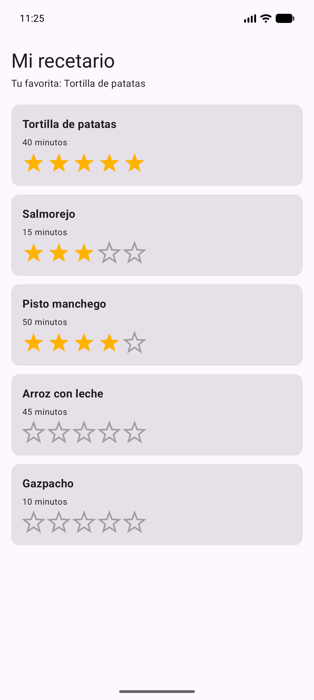

# 🍳 DI-U4 · App Recetas: importar el componente `Valoracion`

**Módulo:** Desarrollo de Interfaces (2º DAM) · **Unidad:** U4.1 Creación de componentes visuales

Aplicación que **no crea** el componente de estrellas: lo **importa** desde su repositorio de GitHub,
[DI-U4-Componente-Valoracion](https://github.com/IsmaelAndroid/DI-U4-Componente-Valoracion), a través de JitPack.

Muestra un recetario. Cada receta se valora pulsando las estrellas y arriba aparece tu favorita.
Usa el componente **con sus valores por defecto**: 5 estrellas ámbar, interactivas.



## 🔌 Las 3 líneas que importan el componente

| Fichero | Qué se añade |
|---|---|
| `settings.gradle.kts` | `maven("https://jitpack.io")` en los repositorios |
| `gradle/libs.versions.toml` | `valoracion = { group = "com.github.IsmaelAndroid", name = "DI-U4-Componente-Valoracion", version.ref = "valoracion" }` |
| `app/build.gradle.kts` | `implementation(libs.valoracion)` |

Y en `MainActivity.kt`:

```kotlin
import com.dam.valoracion.Valoracion

Valoracion(valor = receta.nota, onValorCambiado = onNota)
```

Busca las marcas ⭐ en el código: señalan cada sitio donde aparece el componente importado.

## ▶️ Abrir y ejecutar

1. **Code ▸ Download ZIP**, descomprime en una ruta corta (por ejemplo `C:\DAM\`).
2. Android Studio: **File ▸ Open…** → la carpeta del proyecto → **Trust Project**.
3. Espera a la sincronización: la primera vez Gradle descarga el componente desde JitPack.
4. Ejecuta **app**.

El paso a paso completo está en el PDF de la guía, en el repositorio del componente.
